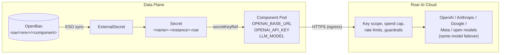

# AI Gateway — Roar AI Cloud Module for OpenChoreo

This module routes component LLM traffic through the [Roar AI Cloud gateway](https://roar-ai.com/gateway), a managed, OpenAI-compatible gateway with 200+ models from OpenAI, Anthropic, Google, Meta and others behind one API.

It ships a single ClusterTrait, `roar-ai-gateway`. Nothing is installed in the cluster: Roar is a hosted service, and the trait wires the gateway endpoint and a per-environment API key into any workload.

## Use Cases

- **One endpoint, many models**: Apps use the standard OpenAI SDK against `OPENAI_BASE_URL`; switch models without code changes
- **Per-environment spend control**: Each environment binds its own Roar key, so development and production have separate spend caps, enforced by Roar (`402 budget_exceeded`)
- **Per-environment models**: Run an inexpensive model in development and a stronger one in production through ReleaseBinding overrides
- **Data guardrails**: Roar's account-level guardrails can redact, block or route sensitive content to a private model before it reaches an outside provider
- **API key management**: Keys stored in OpenBao (or any External Secrets backend), injected via External Secrets Operator

## Architecture



The trait only acts at deploy time. At runtime the pod calls Roar directly over HTTPS; OpenChoreo's ingress gateway is not in the LLM request path.

## Installation

### Step 1: Create Roar API Keys

In the [Roar console](https://cloud.roar-ai.com/console/signup), go to **API keys › New key** and create one key per environment. Give each key the `inference` scope only and a blocking spend cap. Keys are shown once.

### Step 2: Store the Keys in OpenBao

```bash
kubectl exec -it -n openbao openbao-0 -- \
  bao kv put secret/roar/development/support-agent api-key='roar_live_...'
kubectl exec -it -n openbao openbao-0 -- \
  bao kv put secret/roar/production/support-agent api-key='roar_live_...'
```

Any backend behind the data plane's `ClusterSecretStore` works. Store the key under the path you will use as `remoteKey`, in a property named `api-key` (configurable with the `apiKeyProperty` parameter).

### Step 3: Apply the ClusterTrait

```bash
kubectl apply -f https://raw.githubusercontent.com/openchoreo/community-modules/main/ai-gateway-roar/roar-ai-gateway-trait.yaml
```

### Step 4: Allow the Trait on a ComponentType

```bash
kubectl patch clustercomponenttype deployment/service --type=json \
  -p='[{"op":"add","path":"/spec/allowedTraits/-","value":{"kind":"ClusterTrait","name":"roar-ai-gateway"}}]'
```

## Samples

### Support-Triage Agent

A FastAPI agent ([`samples/support-agent/app`](samples/support-agent/app)) that triages support tickets with an LLM tool call. The app only uses the OpenAI SDK.

| File | Purpose |
|---|---|
| [`component.yaml`](samples/support-agent/component.yaml) | Component with the `roar-ai-gateway` trait, and its Workload |
| [`releasebinding.yaml`](samples/support-agent/releasebinding.yaml) | Per-environment Roar keys and model override |

```bash
# 1. Build and push the agent image, then set it in component.yaml
docker build -t <your-registry>/support-agent:0.1.0 samples/support-agent/app
docker push <your-registry>/support-agent:0.1.0

# 2. Store the keys (Step 2) and apply the samples
kubectl apply -f samples/support-agent/component.yaml
kubectl apply -f samples/support-agent/releasebinding.yaml

# 3. Check the key was synced and injected
kubectl get externalsecret -A | grep roar

# 4. Test the agent
curl -s -X POST <endpoint-url>/triage -H 'content-type: application/json' \
  -d '{"text":"Our production API has been returning 503s for 20 minutes and customers cannot log in."}'

# Sample response:
# {"decision":{"team":"platform","priority":"p1","summary":"Production API outage causing login failures"},"model":"deepseek-v4.1-flash"}
```

Each request appears in the Roar console under **Usage**, attributed to the key of the environment that made it.

## Usage

### Attaching the Trait

```yaml
spec:
  traits:
    - kind: ClusterTrait
      name: roar-ai-gateway
      instanceName: llm
      parameters:
        model: deepseek-v4.1-flash
```

### Per-Environment Overrides

`remoteKey` is required for every environment the component is deployed to.

```yaml
spec:
  environment: production
  traitEnvironmentConfigs:
    llm:                                     # trait instanceName
      remoteKey: roar/production/support-agent
      model: claude-sonnet-5-5               # optional
```

In the portal, set these under the component's **Deploy** tab › environment gear icon › **Traits**.

## Trait Parameters Reference

### Parameters (Component)

| Parameter | Type | Default | Description |
|---|---|---|---|
| `model` | string | `llama-3.3-70b` | Model ID routed through Roar |
| `baseUrl` | string | `https://api.roar-ai.com/v1` | Roar gateway base URL |
| `apiKeyProperty` | string | `api-key` | Property in the remote secret holding the key |

### Environment Configs (ReleaseBinding)

| Field | Type | Required | Description |
|---|---|---|---|
| `remoteKey` | string | yes | Secret store path of this environment's Roar key |
| `model` | string | no | Overrides `model` for this environment |

## Resources Created by the Trait

| Resource | Name | Purpose |
|---|---|---|
| `ExternalSecret` | `<name>-<instanceName>-roar` | Syncs the environment's Roar key into a Kubernetes Secret of the same name |

## Injected Environment Variables

| Variable | Value |
|---|---|
| `OPENAI_BASE_URL` | `baseUrl` (default `https://api.roar-ai.com/v1`) |
| `OPENAI_API_KEY` | From the synced Secret |
| `LLM_MODEL` | Environment `model` override, else the component `model` |

## Notes and Limitations

- **Deployments only**: The trait patches `Deployment` workloads (first container).
- **Key rotation**: Env vars are read at pod start. After rotating a key, the Secret refreshes within `refreshInterval` (1h), but running pods keep the old key until restarted. Use a tool such as Stakater Reloader to restart them automatically.
- **Egress policies**: Pods must reach `api.roar-ai.com:443`. With default-deny network policies, allow this egress (FQDN rules need a CNI such as Cilium).
- **Tracing**: Roar returns an `x-roar-request-id` header on every response; log it to correlate OpenChoreo traces with Roar's request logs.
